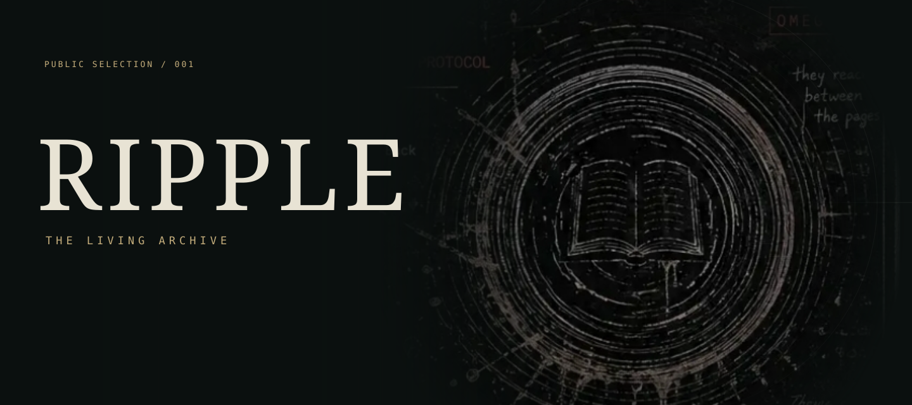
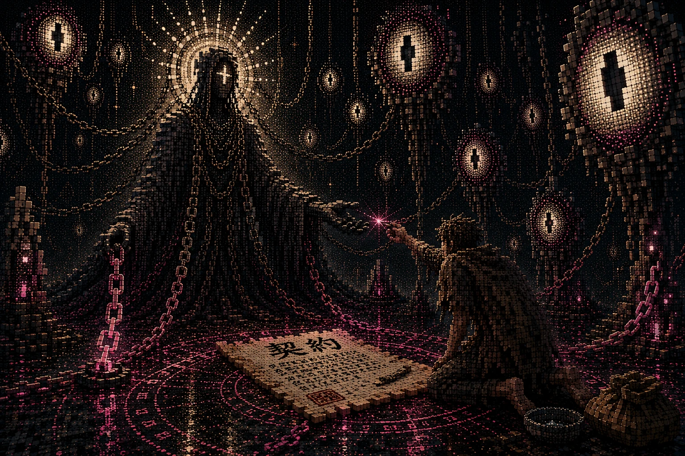
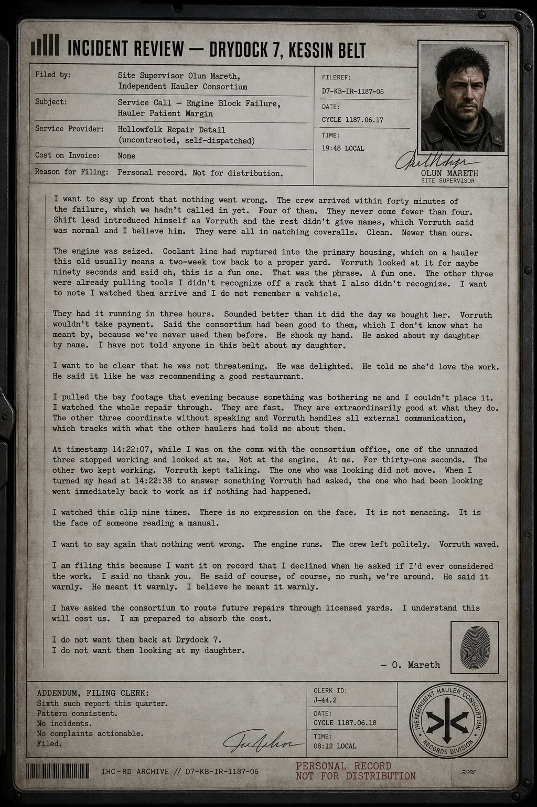
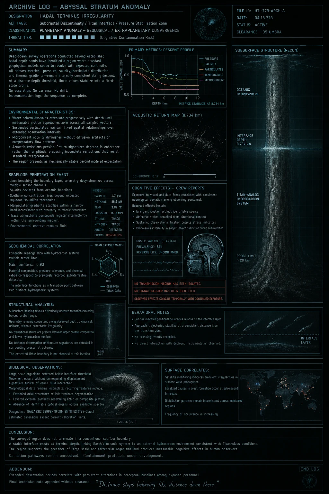
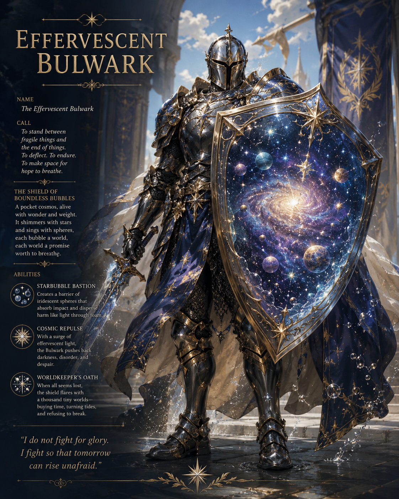
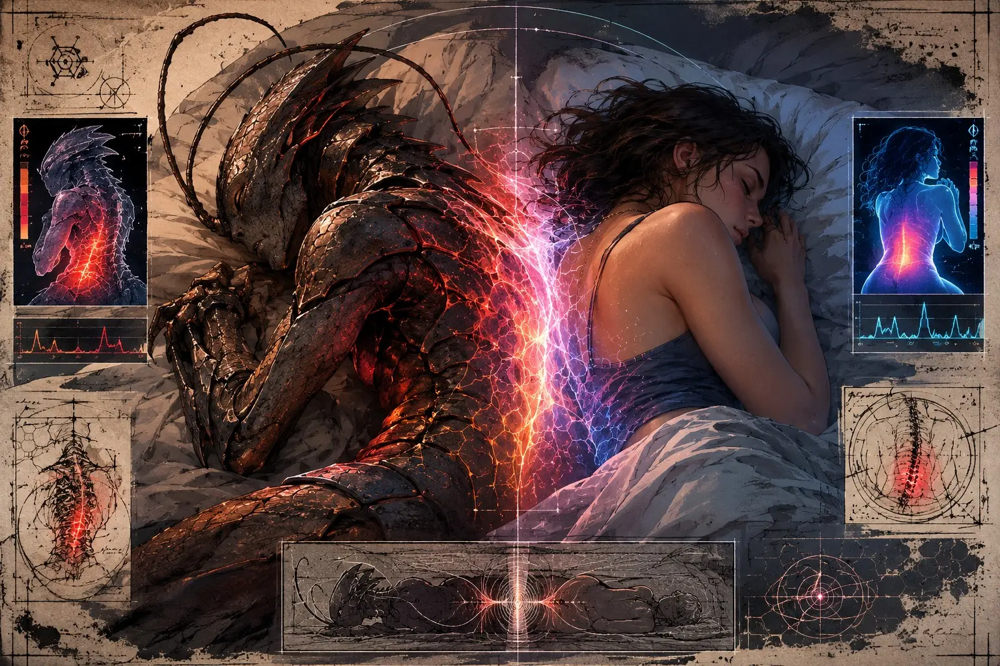

# RIPPLE

### The Living Archive

[**Read the records ↗**](https://wakkatobakka.github.io/ripple/)

Logs, incidents, and observations. Five public records.

## Records

| Illustration | Record | |
|---|---|---|
|  | [**The Bound**](https://wakkatobakka.github.io/ripple/records/the-bound.html) · [text](records/source/the-bound.md) | Every civilization invents the same warning. They disagree only on why. |
|  | [**Drydock 7**](https://wakkatobakka.github.io/ripple/records/drydock-7.html) · [text](records/source/drydock-7.md) | The crew arrived before anyone called. The repair was excellent. A report was filed anyway. |
|  | [**Hadal Terminus**](https://wakkatobakka.github.io/ripple/records/hadal-terminus.html) · [text](records/source/hadal-terminus.md) | The descent continued. Pressure, temperature, and everything else had stopped changing. |
|  | [**Effervesent, the Bulwark**](https://wakkatobakka.github.io/ripple/records/effervesent.html) · [text](records/source/effervesent.md) | Verg sees a knight. The classification system is having a harder time. |
|  | [**Shared Rest**](https://wakkatobakka.github.io/ripple/records/shared-rest.html) · [text](records/source/shared-rest.md) | Two unrelated subjects are sleeping much better. Their coworkers have heard all about it. |

## About

RIPPLE started with me asking AI for Mass Effect-style codex entries to listen to while mowing. It grew into a fictional universe told through incident reports, correspondence, and stories. Cosmic horror, weird humor, and occasional kindness.

Eventually, that universe was scattered across old chats and files. I wanted RIPPLE back. So, with AI’s help, I dug through the material, recovered what I could, and built an archive I could actually navigate and keep writing in. The original text, corrections, and gaps stayed part of the record.

This is a small public selection from that ongoing project.

A human/AI project by Wakka. Still being written.

[Project details](ABOUT.md).

## Navigator

The Android app is still being edited.

## Feedback

[Report a problem](https://github.com/Wakkatobakka/ripple/issues/new/choose). Include the record and what you noticed.
